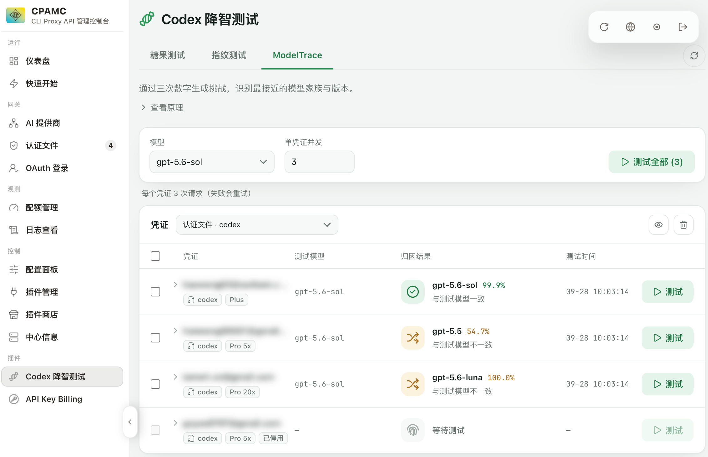

# Codex 降智测试（CLIProxyAPI 插件）

在 [CLIProxyAPI](https://github.com/router-for-me/CLIProxyAPI) 管理面板中用**糖果题**、**指纹检测**、**画鹈鹕**和 **SIWC 检测**测试 Codex 凭证。



## 安装

### CPA 版本要求

最低要求 CPA [v7.3.3](https://github.com/router-for-me/CLIProxyAPI/releases/tag/v7.3.3)。

### 插件商店

CPA 管理面板（CPAMC、CPAMP 或 [Oh My CPA](https://github.com/WizisCool/oh-my-cpa)）插件商店搜索安装 `cpa-codex-candy-eval`，并在面板左侧打开「Codex 降智测试」。

### 人工安装

进入 CPA 工作目录，执行对应的安装命令。macOS 和 Linux：

```sh
curl -fsSL https://raw.githubusercontent.com/haowang02/cpa-plugin-codex-candy-eval/main/install.sh | sh
```

Windows 请先停止 CPA，再在 PowerShell 中运行：

```powershell
irm https://raw.githubusercontent.com/haowang02/cpa-plugin-codex-candy-eval/main/install.ps1 | iex
```

也可以从 [Releases](https://github.com/haowang02/cpa-plugin-codex-candy-eval/releases/latest) 下载对应平台的压缩包，解压后将插件文件重命名为 `cpa-codex-candy-eval-v<版本号>.<扩展名>`，放入对应的 `plugins/<系统>/<架构>/` 目录。

在 CPA 的 `config.yaml` 中启用插件：

```yaml
plugins:
  enabled: true
  dir: "plugins"
  configs:
    cpa-codex-candy-eval:
      enabled: true
```

## 使用

在「凭证」标题右侧选择类型，默认「认证文件 · codex」，也可选择「全部凭证」。点击凭证旁的按钮单独测试，或勾选多个凭证批量测试。未勾选时，批量操作针对当前类型下的全部可用凭证。

### 糖果题

选择模型、推理强度和每凭证次数，点击「测试」。推理强度选择 `none` 时由 CPA 决定。

正确答案为 **21**。展开凭证可查看历次回答，正确率按当前选择的模型和推理强度统计。

### 指纹检测

选择模型，点击凭证旁的「测试」，或勾选凭证批量测试。插件从参考库的 36 道数字挑战中随机抽取 3 道，与参考库中的模型比对，显示最接近的模型、家族及归因概率。测试 gpt-6.1-sol 时命中 gpt-6-astra/6.1-sol，测试 deepseek-flash 时命中 deepseek-v4.1-flash-1017，均视为一致。展开凭证可查看历史记录和详情。

### 画鹈鹕

选择模型、推理强度和版本，点击「测试」。

- **原版**：模型写出一个用 SVG 绘制鹈鹕骑自行车动画的 HTML 页面。
- **多合一版**：模型画一张 SVG 图片，鹈鹕骑车在孙悟空驾驶的飞机机翼上，翅膀托着秦始皇骑的北极熊，并喊出糖果题的答案。

列表和历史记录显示缩略画面，点击即可放大查看，动画在放大后播放。

### SIWC 检测

在 CPA 的「OAuth 登录」中绑定 SIWC，开启凭证的「使用 SIWC」，选择模型后点击「检测」。未绑定的 Codex 凭证会提示先绑定。

`use_siwc` 关闭时无法检测，开启后也会用于该凭证的非 Codex 客户端请求。检测结果区分 SIWC 可用、订阅共享受限、认证异常和额度限制，可作为账号风控的参考。

### 记录与额度

- 测试会消耗凭证额度。糖果题、指纹检测和画鹈鹕每次请求都以新会话的完整 Codex CLI 上下文发出，输入约 1.4 万 Token；SIWC 检测仅发送简短请求。
- 每个凭证的每种测试都保留最近 20 次记录，刷新或重启后仍可查看。
- 点击标签栏右侧的垃圾桶可清空全部测试记录；凭证列表右上角的垃圾桶只清空当前测试的记录。
- 单次请求有时间限制：SIWC 检测 1 分钟，指纹检测 3 分钟，糖果题和画鹈鹕 10 分钟。超时的请求会被中断。
- SIWC 检测仅请求一次；其他测试遇到请求失败或无效回答时最多尝试 3 次。凭证冷却、额度用尽及糖果题答错不重试。耗时和 Token 包含所有重试；CPA 自身的重试由其配置决定。

### 定时巡检

巡检脚本定时用糖果题测试账号，默认跳过 Free 订阅。每个账号先测一次，状态变化须经两次复测确认；降智账号恢复前的复测等待 240 秒。开启自动调整后，脚本改变 priority，并通过 ntfy 或 Bark 通知恢复或降智。部署方法见 [定时糖果巡检](docs/inspection.md)。

也可以补全下面的提示词，发给 Codex、Claude Code 等 AI 助手，让它帮你部署：

```text
请按照 https://raw.githubusercontent.com/haowang02/cpa-plugin-codex-candy-eval/main/docs/inspection.md 中的教程，在这台机器上部署 Codex 降智测试插件的定时巡检。

我的配置（没写的项保持脚本默认值）：
- CPA 地址：
- CPA 管理密钥：
- 巡检频率：（例如每 30 分钟）
- 糖果测试模型和推理强度：（例如 gpt-6.1-sol、low）
- 巡检范围：（例如所有 codex- 开头的认证文件）
- 是否自动调整 priority：（是或否，可指定降智和正常账号的 priority）
- 通知方式：（ntfy 的服务器地址、主题和账号密码，Bark 的推送地址，或不通知）

部署后先手动运行一次，确认巡检能正常完成，再配置 crontab，最后告诉我日志的位置。缺少必要信息时先问我。
```

## 致谢

- [codex-candy-eval](https://github.com/haowang02/codex-candy-eval)
- [LM Fingerpoint Detector](https://github.com/Ikaleio/lm-detector) — 指纹检测使用的数字指纹归因算法与参考库（MIT）
- [LINUX DO](https://linux.do/) - 新的理想型社区
